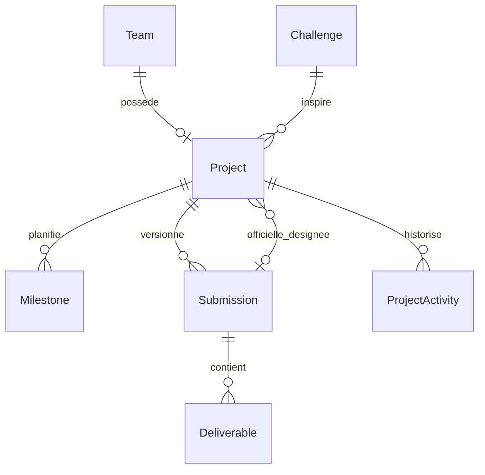

# M3 — Projets, progression et soumissions

Le travail M3 est contenu dans `projects/`. La seule extension partagée est un
bloc de navigation vide dans `templates/base.html`, ajouté à la demande de
l’utilisateur pour afficher Mes projets dans le menu. Aucun fichier métier
existant de M1, M2, accounts, core ou config n’est modifié.
Les modèles, services et templates existants sont réutilisés en lecture/import.

## Lancer M3 sans modifier le travail des autres membres

Depuis la racine du projet, après configuration de PostgreSQL dans `.env` :

```bash
uv run python manage.py check --settings=projects.settings_m3
uv run python manage.py check_database --settings=projects.settings_m3 && uv run python manage.py migrate --settings=projects.settings_m3
uv run python manage.py runserver 127.0.0.1:8001 --settings=projects.settings_m3
```

Ouvrir `/projects/` pour les projets privés et `/projects/gallery/` pour la galerie.
Le paramètre `--settings=projects.settings_m3` active M3 explicitement ; le
lancement habituel conserve la configuration des autres membres. Le port 8001
permet de garder le serveur initial sur le port 8000.
Les migrations ajoutent uniquement les tables M3, avec des relations vers les
tables existantes. Aucune migration d’un autre membre n’est réécrite.

## Parcours

1. Un participant rejoint une équipe valide M2.
2. Pendant la phase développement ou soumission, un membre crée sa fiche projet
   depuis `/projects/`, en choisissant un challenge publié du même événement.
3. Les membres planifient les étapes et leur progression dans le kanban.
   Le pourcentage détermine automatiquement l’état : 0 % à faire, 1–99 % en cours,
   100 % terminé.
4. Ils créent une version et y ajoutent dépôt, présentation, vidéo ou démo.
5. Le capitaine soumet pendant la phase soumission, strictement avant la deadline.
6. La fiche, les exigences et les références des livrables sont enregistrées dans
   un snapshot officiel. Le hash Git complet du dépôt évalué est obligatoire.
7. Le capitaine autorise la publication des livrables ; l’organisateur valide
   leur publication dans la galerie.

Un organisateur peut réouvrir un projet avec justification et une limite future
avant la fin de l’événement. La précédente version officielle reste figée et
consultable par les personnes autorisées. La publication est retirée, et la
substitution est historisée. Les éditions archivées sont en lecture seule.

## Démonstration locale

```bash
uv run python manage.py seed_m3_demo --settings=projects.settings_m3
```

Cette commande crée seulement une édition distincte `m3-project-lab`, deux
équipes et cinq comptes de démonstration. Une seconde exécution ne modifie rien.
Les événements et comptes préexistants ne sont pas réinitialisés.

- `m3.captain` : Campus Care, progression 60 %, version 3 officielle et publiée.
- `m3.captain2` : Campus Share, version 1 en brouillon pour essayer les formulaires.
- `m3.builder` / `m3.designer` : membres des équipes correspondantes.
- `m3.organizer` : revue de publication et dérogations.

Mot de passe local de démonstration : `Demo-M3#2026`. Les URL et commits présents
dans la démo sont fictifs. Le seed est refusé si `DEBUG=False`.

## Relations M3



Les liens sont contrôlés localement (HTTPS, sans identifiants ni adresses privées
littérales), sans requête réseau. Le capitaine confirme leur accessibilité au jury
et le respect des exigences textuelles du challenge ; leur contenu distant n’est
pas automatiquement vérifié ni archivé. Le commit fixe la référence du code.
Les fichiers PDF/ZIP/MP4 sont limités à 20 Mo avec contrôle de signature et SHA-256.
Ce contrôle ne constitue pas une analyse antivirus.

## Fichiers et permissions

Les fichiers sont stockés dans `projects/private_files/`, exclu par le
`.gitignore` propre à M3 et situé hors de `MEDIA_ROOT`. Les téléchargements
passent par une vue autorisée ; les anciennes versions privées ne deviennent pas
publiques avec la version actuellement publiée. L’admin M3 est consultatif.
Les écritures passent par `projects.services`, avec verrou utilisateur puis
événement puis projet, compatible avec l’ordre des verrous M2.

## Contrats M5 et IA

`Project.official_submission` désigne la version officielle courante.
`Submission.snapshot` et ses livrables sont figés après officialisation.
M5 devra contrôler ses affectations et conflits avant d’utiliser cette référence.
Aucun accès global n’est accordé aux utilisateurs ayant seulement le rôle JURY.

`projects.services.copilot_input(actor=..., project=...)` fournit le problème,
la solution, la stack et le pitch aux personnes autorisées. Aucun moteur IA ni
transfert externe n’est effectué. Le moteur collectif reste une intégration future.

`projects.services.metrics(event)` expose les compteurs M3 au fournisseur M1.
Le fichier `settings_m3.py` l’active sans remplacer le fournisseur M2.

La configuration M3 ajoute aussi `integration_templates/` devant les templates
partagés. Son `base.html` hérite de la base existante et ajoute Mes projets au
menu principal (Galerie pour les visiteurs). La base partagée possède seulement
un bloc d’extension vide `project_navigation`, ajouté à la demande de l’utilisateur.
Le serveur initial garde son menu habituel quand M3 n’est pas activé.

## Validation

```bash
uv run python manage.py test projects --keepdb --noinput --settings=projects.settings_m3
uv run python manage.py makemigrations --check --dry-run --settings=projects.settings_m3
uv run python manage.py test --keepdb --noinput --settings=projects.settings_m3
```

Les tests utilisent exclusivement `test_hackflow_db`. Ils couvrent permissions,
deadline exacte, dérogations, versions figées, fichiers privés, publication,
CSRF, parcours des écrans et numérotation concurrente.

Validation du 24 octobre 2026 : 124 tests de régression passent, dont 23 tests
M3. Le contrôle Django ne signale aucune anomalie et aucune migration ne manque.
Les deux serveurs répondent HTTP 200 : projet initial sur 8000, galerie M3 sur 8001.
Après correction de l’édition du pourcentage : 24 tests M3 passent, dont un test
du formulaire pour 4 %, 99 %, 100 %, retour à 0 % et refus des valeurs hors limites.

Les traductions françaises/anglaises M3 sont autonomes dans `projects/locale/` ;
les fichiers `.po` et `.mo` sont livrés sans modifier le catalogue commun.
Les vérifications HTTP locales couvrent la galerie dans les deux langues, la
connexion de démonstration, le tracker, les versions et le chargement du CSS.
La revue visuelle mobile/bureau reste à faire dans un navigateur : aucun
navigateur n’était connecté aux outils de cette session.

## Intégration collective ultérieure

Après revue par l’équipe, le responsable de l’intégration pourra reprendre dans
la configuration commune les ajouts explicites de `settings_m3.py` et la route
de `urls_m3.py`, puis ajouter les liens de navigation souhaités. Ces fichiers
communs sont volontairement laissés intacts dans cette livraison isolée.

## Tableau de suivi

Le tracker commence par un tableau à trois listes, avec compteurs réels, cartes
compactes, progression et dates. Les liens de titre ouvrent l’édition ; le menu
de chaque carte regroupe modifier/supprimer. Ajouter une étape depuis une liste
préremplit sa progression (0 %, 1 % ou 100 %). Sur mobile, les listes défilent
horizontalement. Les liens À propos, Versions et Activité rejoignent leurs
sections. Les thèmes et couleurs partagés sont réutilisés sans les modifier.
